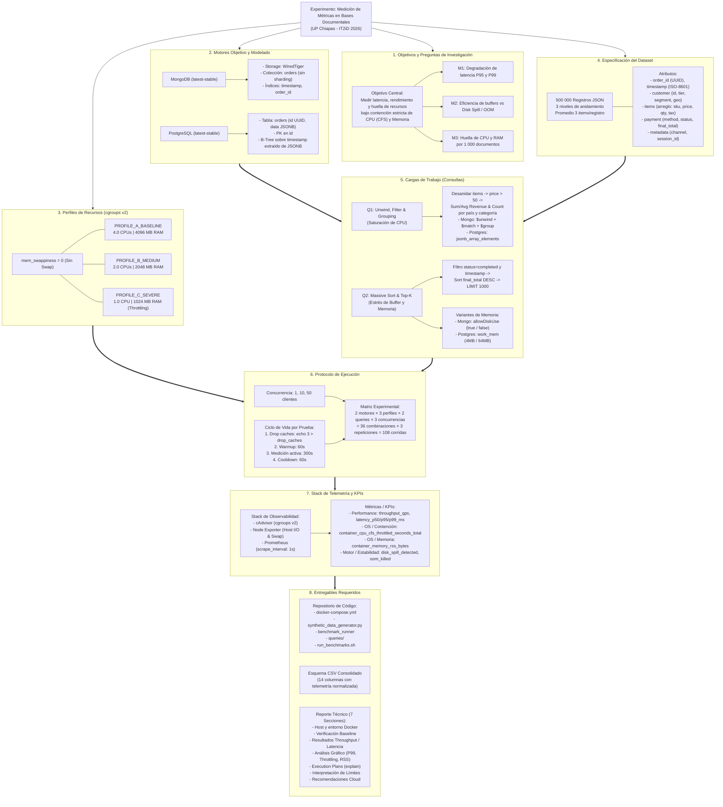

# Grafo de Conocimientos: Medición de Métricas en Bases Documentales

Este documento contiene la representación visual estructurada (grafo de conocimiento en formato Mermaid) de la arquitectura experimental, variables, cargas de trabajo y flujo de resultados definidos en el `playbook.pdf`.

---

## 1. Diagrama de Relaciones y Entidades

---

## 2. Descripción de Subgrafos y Conexiones

1. **Subgrafo de Objetivos y Métricas:** Establece el marco conceptual enfocado en evaluar cómo la limitación de hardware en microservicios/contenedores altera la latencia de cola (P95/P99) y cómo responden los motores ante insuficiencia de buffers en memoria.
2. **Subgrafo de Motores y Modelado:** Contrasta la arquitectura nativa documental basada en documentos BSON (MongoDB) con un modelo híbrido relacional que indexa y almacena documentos JSONB mediante tipos binarios estructurados (PostgreSQL).
3. **Subgrafo de Perfiles de Recursos:** Modela los tres escalones de aislamiento de Docker basados en cgroups v2 (`BASELINE`, `MEDIUM`, `SEVERE`), donde la supresión de swap (`mem_swappiness = 0`) asegura que la memoria no tenga rutas de escape.
4. **Subgrafo de Cargas de Trabajo (Consultas):**
   * **Q1** pone a prueba la capacidad de CPU deserializando 500,000 registros anidados.
   * **Q2** somete a prueba los algoritmos de ordenamiento interno (in-memory sort vs external merge sort en disco) ajustando parámetros de motor (`allowDiskUse` y `work_mem`).
5. **Subgrafo de Protocolo y Matriz:** Diseña la repetibilidad estadística mediante 108 iteraciones con limpieza estricta de cachés de kernel (`drop_caches`), precalentamiento y periodos de estabilización.
6. **Subgrafo de Telemetría:** Vincula el raspado en tiempo real a intervalos de 1 segundo de Prometheus con las métricas de contención CFS provistas por cAdvisor a nivel de cgroups v2.
7. **Subgrafo de Entregables:** Mapea cómo los resultados de la telemetría alimentan el dataset CSV final y las 7 secciones analíticas del reporte técnico de investigación.
