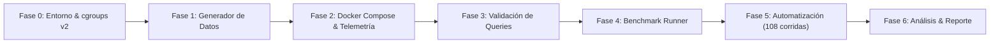

# Guía de Inicio: Prerrequisitos, Requisitos y Hoja de Ruta

**Asignatura / Contexto:** Bases de Datos en la Nube (2026) · Universidad Politécnica de Chiapas (IT2iD)  
**Documento Fuente:** `playbook.pdf`  
**Título:** Medición de métricas en bases documentales: Contención de CPU y memoria en agregaciones JSON (MongoDB frente a PostgreSQL JSONB)

---

## 1. ¿Por Dónde Empezar? (Ruta de Implementación Paso a Paso)

El mayor riesgo de este benchmark es invertir tiempo en ejecutar pruebas sin tener la certeza de que los límites de **cgroups v2** y la **telemetría** están funcionando correctamente. Se recomienda seguir estrictamente este orden:



### Fase 0: Preparación del Entorno Host
* Dado que el entorno de desarrollo puede ser Windows, la ejecución de flush de caché del kernel (`echo 3 > /proc/sys/vm/drop_caches`) y el soporte nativo de **cgroups v2** requieren un entorno Linux.
* **Acción inmediata:** Utilizar **WSL2 (Ubuntu 22.04 / 24.04)** con Docker Desktop habilitado con soporte WSL2 y cgroups v2 unificado, o una máquina virtual/servidor Linux dedicado.

### Fase 1: Generador de Datos Sintéticos (`synthetic_data_generator.py`)
* Implementar el script generador para los **500,000 registros JSON**.
* Asegurarse de que genere los 3 niveles de anidamiento (`customer.geo`, arreglo de `items`, `payment`, `metadata`).
* Exportar a archivos JSON/NDJSON para facilitar la carga masiva (`mongoimport` y `COPY`/script en PostgreSQL).

### Fase 2: Configuración de Docker Compose y Stack de Telemetría
* Crear el archivo `docker-compose.yml` con servicios para:
  * **MongoDB** (con variables de entorno para aplicar los límites de recursos de cgroups).
  * **PostgreSQL** (con volumen y variables configurables).
  * **cAdvisor** (mapeando `/sys/fs/cgroup`).
  * **Node Exporter**.
  * **Prometheus** (con `scrape_interval: 1s`).
* Probar la inyección de los 3 perfiles de recursos (`PROFILE_A`, `PROFILE_B`, `PROFILE_C`).

### Fase 3: Ingesta, Índices y Validación de Consultas (`queries/`)
* Ingestar los 500k registros en ambos motores.
* Crear los índices requeridos:
  * MongoDB: `order_id` y `timestamp`.
  * PostgreSQL: PK `id`, e índice B-Tree sobre `(data->>'timestamp')`.
* Validar que **Q1** y **Q2** devuelvan los mismos resultados lógicos en ambos motores.
* Ejecutar y documentar los planes de ejecución base (`explain("executionStats")` y `EXPLAIN ANALYZE BUFFERS`).

### Fase 4: Implementación del Runner de Carga (`benchmark_runner`)
* Crear el script de carga (usando **Python multiproceso/asyncio** o **k6**).
* Implementar soporte de concurrencia parametrizable (1, 10, 50 clientes).
* Medir los tiempos individuales de respuesta para derivar P50, P95 y P99.

### Fase 5: Automatización de la Matriz (`run_benchmarks.sh`)
* Orquestar las 36 combinaciones $\times$ 3 repeticiones = **108 corridas**.
* Incluir en el loop: `drop_caches` $\rightarrow$ 60s Warmup $\rightarrow$ 300s Medición $\rightarrow$ 60s Cooldown $\rightarrow$ Extracción de métricas de Prometheus $\rightarrow$ Escritura al CSV.

### Fase 6: Análisis de Resultados y Reporte
* Procesar el CSV de resultados con scripts de análisis (Pandas/Matplotlib o Seaborn).
* Redactar las 7 secciones del reporte técnico final.

---

## 2. Prerrequisitos

### 2.1. Entorno de Sistema Operativo y Kernel
1. **Linux Kernel compatible con cgroups v2 unificado:**
   * Distribución Linux (Ubuntu 22.04 LTS o superior) o WSL2 actualizado con cgroups v2 (`/sys/fs/cgroup/cgroup.controllers` debe existir).
2. **Permisos de Administrador (`root` / `sudo`):**
   * Imprescindibles para ejecutar `sync; echo 3 > /proc/sys/vm/drop_caches` entre cada corrida experimental.

### 2.2. Herramientas de Software
* **Docker Engine (v24.0+)** y **Docker Compose (v2.20+)**.
* **Python 3.10+**:
  * Librerías para generación de datos: `faker`, `uuid`, `json`, `random`.
  * Clientes de bases de datos: `pymongo`, `psycopg2-binary` o `asyncpg`.
  * Telemetría y análisis: `requests`, `pandas`, `matplotlib`, `seaborn`.
* **Herramientas cliente:** `mongosh` / `mongoimport`, `psql`.
* **Shell:** Bash compatible para ejecutar `run_benchmarks.sh`.

### 2.3. Especificaciones de Hardware Recomendadas
* **CPU:** Mínimo 4 núcleos físicos / 8 hilos (ideal 8+ núcleos para que el proceso generador de carga/benchmark no compita con los núcleos asignados al contenedor bajo prueba).
* **Memoria RAM:** Mínimo 16 GB en el host físico (el contenedor demandará hasta 4 GB, más el consumo de Prometheus, cAdvisor, Node Exporter, el SO y los clientes de prueba).
* **Almacenamiento:** Unidad de estado sólido (SSD NVMe preferentemente) con al menos 30 GB de espacio libre para alojar imágenes Docker, volúmenes de 500k registros y datos temporales de ordenamiento (*disk spill*).

---

## 3. Requisitos Funcionales (RF)

| ID | Nombre | Descripción |
| :--- | :--- | :--- |
| **RF-01** | **Generación de Dataset** | El script `synthetic_data_generator.py` debe generar de forma determinista o consistente exactamente 500,000 registros JSON respetando la jerarquía de 3 niveles: `order_id`, `timestamp`, `customer` (con `geo`), `items` (promedio 3 items), `payment` y `metadata`. |
| **RF-02** | **Carga e Indexación en MongoDB** | El entorno debe permitir ingestar los 500k documentos en la colección `orders` (WiredTiger sin sharding) y crear índices simples en `timestamp` y `order_id`. |
| **RF-03** | **Carga e Indexación en PostgreSQL** | El entorno debe permitir crear la tabla `orders (id UUID PRIMARY KEY, data JSONB)`, cargar los 500k registros y crear un índice B-Tree sobre la expresión del campo `timestamp` del JSONB. |
| **RF-04** | **Ejecución de Consulta Q1 (CPU Bound)** | Ejecutar el pipeline de desanidado (`$unwind` / `jsonb_array_elements`), filtrar `price > 50`, calcular ingresos y agrupar por país y categoría en ambos motores de forma semánticamente idéntica. |
| **RF-05** | **Ejecución de Consulta Q2 (Memory Bound)** | Filtrar órdenes `completed` a partir del `2026-01-01`, ordenar descendentemente por `payment.final_total` y limitar al Top-1000 sin índices en el total. |
| **RF-06** | **Gestión de Variantes de Memoria en Q2** | El runner debe permitir alternar: <br>• MongoDB: `allowDiskUse: false` y `allowDiskUse: true`. <br>• PostgreSQL: `SET work_mem = '4MB'` y `SET work_mem = '64MB'`. |
| **RF-07** | **Inyección de Concurrencia** | El cliente de carga debe poder generar tráfico constante con 1, 10 y 50 clientes concurrentes durante las fases de medición. |
| **RF-08** | **Control del Ciclo de Vida** | El script `run_benchmarks.sh` debe aplicar el ciclo completo por prueba: vaciado de cachés del kernel (`drop_caches`), 60s de precalentamiento (*warmup*), 300s de medición sostenida y 60s de reposo (*cooldown*). |
| **RF-09** | **Recolección y Exportación CSV** | Extraer las métricas desde Prometheus y la herramienta de benchmark, consolidándolas en un archivo CSV con las 14 columnas exactas del esquema definido en el playbook. |
| **RF-10** | **Captura de Planes de Ejecución** | El entorno debe permitir extraer y almacenar los planes de ejecución reales (`explain executionStats` y `EXPLAIN ANALYZE BUFFERS`) para ambas consultas en cada perfil. |

---

## 4. Requisitos No Funcionales (RNF)

| ID | Categoría | Requisito / Criterio de Aceptación |
| :--- | :--- | :--- |
| **RNF-01** | **Aislamiento de Recursos (cgroups v2)** | Los contenedores de BD deben configurarse estrictamente con cuotas CFS y límites de memoria: <br>• Baseline: 4.0 CPUs, 4096 MB RAM. <br>• Medium: 2.0 CPUs, 2048 MB RAM. <br>• Severe: 1.0 CPU, 1024 MB RAM (throttling activo). |
| **RNF-02** | **Supresión de Memoria Swap** | Todos los contenedores bajo prueba deben forzar `mem_swappiness = 0` (o `memory-swap` igual al límite de memoria) para evitar que el kernel use disco como escape y garantizar que la presión de RAM sea real. |
| **RNF-03** | **Frecuencia de Telemetría** | Prometheus debe configurarse con un `scrape_interval: 1s` estricto para capturar con precisión los picos de uso de CPU y estrangulamiento de cuota CFS (`cfs_throttled_seconds`). |
| **RNF-04** | **Repetibilidad y Validez Estadística** | Cada una de las 36 celdas de la matriz debe ejecutarse exactamente 3 veces en idénticas condiciones iniciales (cachés limpias y periodo de calentamiento idéntico). |
| **RNF-05** | **Resiliencia ante OOM y Errores** | El runner de benchmark y el script de orquestación no deben romperse si un contenedor sufre un *OOM-kill* o una consulta falla por falta de memoria; el evento debe registrarse con `oom_killed = true` o `status = failed` y continuar con el siguiente escenario. |
| **RNF-06** | **Aislamiento de la Carga** | El script de benchmark (k6 o Python) debe ejecutarse preferentemente en núcleos separados de los que están asignados al contenedor de la base de datos para no distorsionar la medición de latencias. |
| **RNF-07** | **Precisión Temporal** | Todas las marcas de tiempo deben sincronizarse usando épocas Unix (`timestamp_epoch`) en segundos o milisegundos para permitir la correlación directa entre los logs del cliente de carga y las series temporales de Prometheus. |

---

## 5. Resumen del Esquema CSV de Salida

Para cumplir con la sección 8.2 del playbook, los datos de telemetría y ejecución se deben registrar con esta cabecera:
```csv
timestamp_epoch,engine,profile,query_id,concurrency,run_number,throughput_qps,latency_p50_ms,latency_p95_ms,latency_p99_ms,cpu_throttled_seconds,max_rss_mb,disk_spill,status
```
